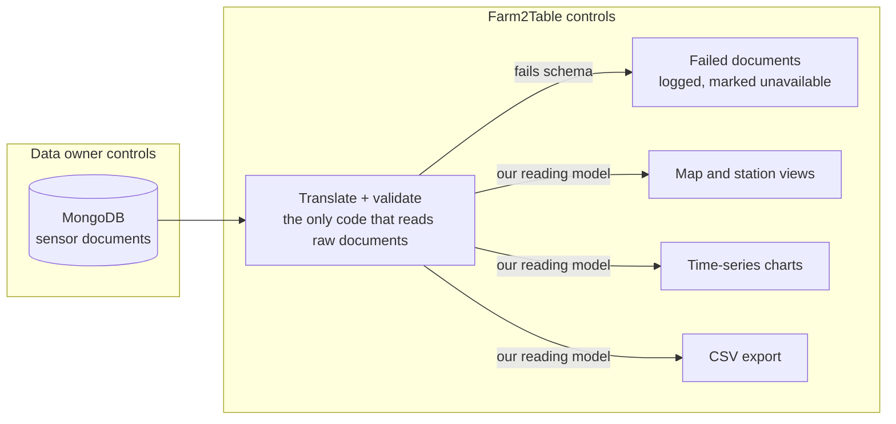

# RFC 0002: Isolating Farm2Table from the MongoDB Document Format

| Field | Value |
| --- | --- |
| Status | Draft, open for comments |
| Author | Aron Meraz, Deployment Owner |
| Decision Date | TBD |
| Deciders | Farm2Table team; Project Partners |
| Supervised By | N/A |

## Problem and context

Farm2Table must decide how much of its code depends on the shape of the sensor documents stored in MongoDB, a database our team reads from but does not control. The team has already decided to build a standalone site, separate from Ear2Earth, that pulls sensor data from MongoDB. That makes the document format the main contract between our site and the lab's data, and right now nothing protects it.

Each document carries field names, nesting, timestamp formats, and units chosen by the data owner. The project description warns about messy, missing, and real-world data, and says stations carry different combinations of sensors. Every one of those differences has to be handled somewhere.

**Why now.** No feature has been written against the documents yet. Choosing a boundary now costs a few days. After 30 weeks and two teams of features reading raw documents, the same change means editing every query and component and re-testing all of them.

**What happens if we do nothing.** The map, time-series plots, comparison views, and CSV export each read raw fields directly. If the data owner renames a field, adds a sensor model, or changes the timestamp format, many features break at once. Worse, they may fail silently: an empty chart looks like a quiet day, not a bug.

## Options

| Option | What it is | Real costs |
| --- | --- | --- |
| 0. Do nothing | Every feature queries MongoDB and reads raw document fields directly | Nothing up front; every upstream change breaks many features, often silently |
| A. Translation layer | One backend module maps MongoDB documents to our own model, e.g. station ID, UTC timestamp, variable, value, unit; nothing else touches raw documents | A few days to design our model and write the mapping; every new sensor type needs a mapping entry |
| B. Translation layer plus validation | Option A, plus every document is checked against a schema at the boundary; documents that fail are logged and shown as "unavailable" instead of being drawn wrong | A few more days; the team must decide what counts as a bad document and who gets alerted |
| C. Ask the data owner for a stable contract | Request a versioned schema or a promise to announce changes, and code against it | Little code; depends entirely on someone else's priorities and schedule |

These are not exclusive: C can sit alongside A or B.

## Analysis

Option B gives the most protection for the cost: a format change breaks one module and shows up in a test, not across the site.

| Criterion | 0. Do nothing | A. Translation layer | B. Layer + validation | C. Stable contract |
| --- | --- | --- | --- | --- |
| Upfront effort | None | A few days | About a week | A conversation, then waiting |
| Places to fix after a format change | Every feature that reads the field | One module | One module | Depends on whether the promise holds |
| Detects bad or changed data | No; fails silently | Partly; mapping may throw | Yes; failures logged and counted | No, unless announced |
| Handles mixed sensor sets | Each feature on its own | Once, in the mapping | Once, and checked | Not addressed |
| Performance cost | None | Small per-document mapping | Mapping plus a schema check | None |
| Control | Ours, but fragile | Ours | Ours | The data owner's |

*Effort figures are my estimates for our team, not measurements.*

**Maintainability.** This is a known pattern. Microsoft's Azure Architecture Center describes an anti-corruption layer: one system talks to another through a layer that holds all the translation logic, so the first system keeps its own data model ([Anti-corruption Layer pattern](https://learn.microsoft.com/azure/architecture/patterns/anti-corruption-layer)). The same page notes the costs: added latency and one more component to maintain. For us that component is a module inside our backend, not a separate service, so the cost is small.

**Robustness.** Fowler's Tolerant Reader advises consumers to read only the fields they need and ignore the rest, so additions upstream don't break them ([Tolerant Reader](https://www.martinfowler.com/bliki/TolerantReader.html)). Option B follows that: the schema checks only the fields we use, so a new sensor or extra field passes through harmlessly, while a renamed or missing field fails loudly.

**Correctness.** Units and time zones are converted in exactly one place. That keeps the map, charts, and CSV export consistent with each other, which the project description lists as a requirement.

**Performance.** Mapping and validating one document is cheap compared with the database query that fetched it. 

**Why not C alone.** A promise is useful, but it doesn't catch mistakes, and we can't verify it. It works best as an addition to B: we can share our schema and its tests with the data owner, the next step Fowler describes toward consumer-driven contracts ([Consumer-Driven Contracts](https://www.martinfowler.com/articles/consumerDrivenContracts.html)).

## Recommendation and verification plan

I recommend Option B: one translation-and-validation module in our backend is the only code allowed to read raw MongoDB documents. Everything else in Farm2Table uses our own reading model.

If the data owner changes the format, only the module changes; failed documents are flagged instead of drawn wrong.

Our reading model, to be confirmed by the team: station ID, sensor type, variable name, value, unit, timestamp in UTC, and a quality flag (ok, missing, stale, invalid).

**How we will know it worked.** Each criterion below is checked in CI or staging by the end of week 8:

- [ ] **Contract tests.** A fixture set of documents covers every station type, plus edge cases: a missing field, an unknown sensor, a null value, an odd timestamp. CI fails if any fixture maps incorrectly.
- [ ] **One place to fix.** Renaming one field in a test fixture causes failures only in the translation module's tests, not in front-end or feature tests.
- [ ] **No raw access.** A lint rule or code search in CI fails if any file outside the module imports the MongoDB driver.
- [ ] **Validation in staging.** After each staging deploy, a job validates the latest day of real documents and reports the count that fail. Any nonzero count opens an issue.
- [ ] **Visible gaps.** A station with invalid data shows "unavailable" on the map and in charts, verified by a front-end test using an invalid fixture.
- [ ] **Performance.** A 30-day query for one station stays under certain amount of time (Time will be decided later) with validation on.

**What would show it was wrong.** Validation rejects so many real documents that the site is mostly "unavailable," or the module becomes a bottleneck that slows both teams. Either triggers a review: loosen the schema toward a more tolerant reader, or split the module by sensor type.

## Constraints

- **Data ownership.** The sensor data belongs to the lab and its research sites. Our module only reads; it never writes back or "fixes" documents in MongoDB.
- **Constraint we can't change.** The document format belongs to the data owner.

## Delegation and validation

**What I handed to AI.** I used Claude to brainstorm RFC topics fitting my Deployment Owner role, drafted this RFC's structure and possible option sets, and reviewed sources on anti-corruption layers and tolerant readers. 

**Where I stopped and validated myself.**

The team has not started implementing code yet, instead we have been doing research. 

## Decision

**Status:** Pending.

The team has not accepted or rejected this proposal. The final decision, date, and decision chair will be recorded after review.

## Sources

- [Microsoft Azure Architecture Center: Anti-corruption Layer pattern](https://learn.microsoft.com/azure/architecture/patterns/anti-corruption-layer)
- [Martin Fowler: Tolerant Reader](https://www.martinfowler.com/bliki/TolerantReader.html)
- [Ian Robinson: Consumer-Driven Contracts, on martinfowler.com](https://www.martinfowler.com/articles/consumerDrivenContracts.html)
